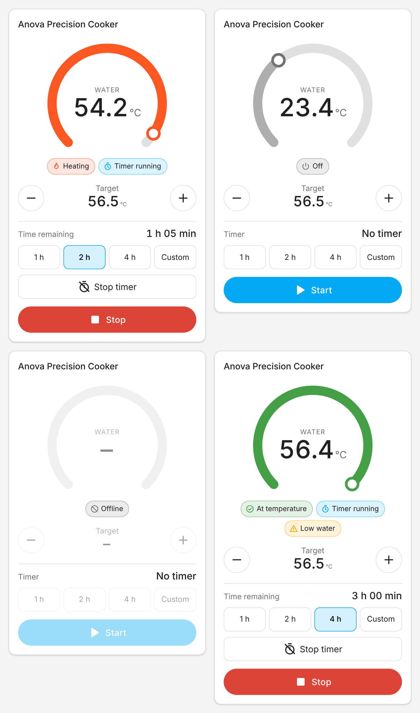
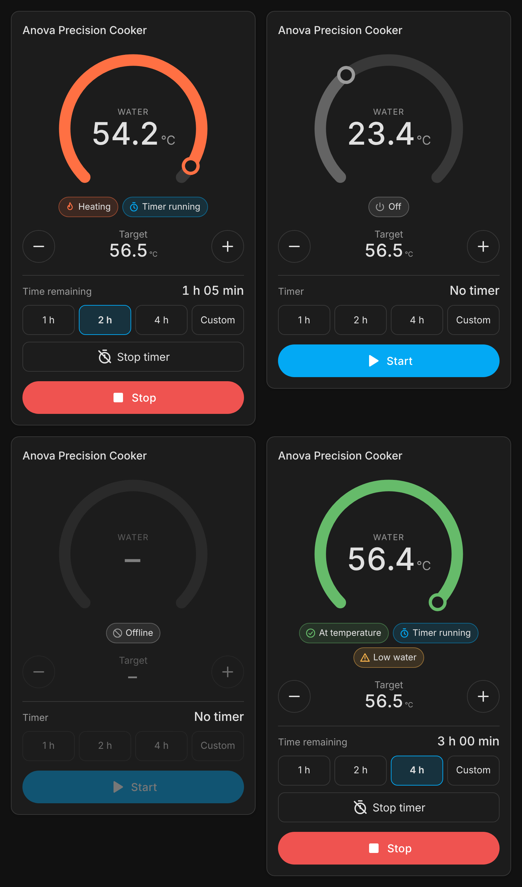

# Anova Precision Cooker (Bluetooth)

[](https://hacs.xyz)
[](https://github.com/gielk/ha-anova/releases)
[](LICENSE)

Control an original Anova Precision Cooker from Home Assistant over local Bluetooth. No cloud and no account.

## Why this exists

Anova ended app support for the original Bluetooth and Bluetooth+WiFi Precision Cookers after 28 September 2025. Local Bluetooth is the only way left to control them.

This integration talks to the cooker directly over Bluetooth LE. It uses the Bluetooth stack that is built into Home Assistant. There is no cloud and no account.

## Supported cookers

Supported in this release:

* Anova Precision Cooker, Bluetooth only (800 W).
* Anova Precision Cooker, Bluetooth and WiFi (900 W).

These cookers advertise as "Anova" over Bluetooth.

Not supported yet:

* Anova Precision Cooker Nano. It uses a different Bluetooth protocol.
* Anova Precision Cooker 3.0 and Pro. They also use a different protocol. Use the [Anova integration](https://www.home-assistant.io/integrations/anova/) in Home Assistant Core for these.

## Features

* Climate entity to set the target temperature and to turn heating on or off.
* Sensors for current temperature, target temperature, timer, status and signal strength.
* Binary sensor that shows when the cooker is cooking.
* Timer number and start and stop timer buttons.
* Select to switch the cooker between Celsius and Fahrenheit.
* Actions `anova_ble.start_cook` and `anova_ble.stop_cook`.
* Diagnostics download for bug reports.
* Dashboard card that loads by itself.
* Works with a local Bluetooth adapter and with ESPHome Bluetooth proxies.

## Install

Requires Home Assistant 2026.10.0 or newer.

Click this button if you use My Home Assistant. It opens HACS and adds this repository.

[](https://my.home-assistant.io/redirect/hacs_repository/?owner=gielk&repository=ha-anova&category=integration)

To install by hand:

1. Open HACS in Home Assistant.
2. Click the three dots in the top right corner.
3. Click Custom repositories.
4. Enter `https://github.com/gielk/ha-anova`. Choose Integration as the type. Click Add.
5. Search for Anova Precision Cooker (Bluetooth) and click Download.
6. Restart Home Assistant.

## Set up

Close the Anova app on your phone before you set up the integration. The cooker accepts only one Bluetooth connection. If the phone holds the connection, Home Assistant cannot reach the cooker.

### Option 1: discovery

1. Go to Settings, Devices & services.
2. Under Discovered, click Add on the cooker. It is named after its Bluetooth address, for example `Anova (2D60)`.
3. Follow the steps on the screen.

### Option 2: add it manually

Click this button to start the setup:

[](https://my.home-assistant.io/redirect/config_flow_start/?domain=anova_ble)

Or do it by hand:

1. Go to Settings, Devices & services.
2. Click Add integration.
3. Search for Anova Precision Cooker (Bluetooth).
4. Pick your cooker from the list.

## Options

Go to Settings, Devices & services, Anova Precision Cooker (Bluetooth), and click Configure.

| Option | Default | Allowed values | What it does |
| --- | --- | --- | --- |
| Poll interval | 15 seconds | 5 to 300 seconds | How often Home Assistant reads the cooker. |
| Connection mode | Per poll | Per poll or keep connected | How the Bluetooth link is handled. See below. |

Connection modes:

* **Per poll** (default): Home Assistant connects, reads the cooker, and disconnects again. Other apps can connect in between. The trade off is one reconnect for every poll.
* **Keep connected**: Home Assistant holds one connection open. Updates are faster and there are fewer reconnects. The trade off is that the phone app cannot connect while Home Assistant holds the link.

## Entities

A new cooker is named after the last 4 characters of its Bluetooth address, for example `Anova (2D60)`. Its entity IDs then start with `anova_2d60`, like `climate.anova_2d60`. The IDs in this README use that example. Yours will have your own 4 characters.

| Platform | Entity (key) | Notes |
| --- | --- | --- |
| `climate` | `cooker` | Modes are off and heat. Uses the unit of the cooker. Shows heating when the water is more than 0.5 degrees below the target. |
| `sensor` | `current_temperature` | Water temperature in the unit of the cooker. |
| `sensor` | `target_temperature` | Target temperature in the unit of the cooker. |
| `sensor` | `timer_remaining` | Minutes left on the timer. |
| `sensor` | `status` | Cooker status, for example running or low water. |
| `sensor` | `rssi` | Bluetooth signal strength in dBm. Diagnostic, disabled by default. |
| `binary_sensor` | `cooking` | On while the cooker is cooking. |
| `binary_sensor` | `timer_running` | On while the timer counts down. |
| `number` | `timer` | Timer from 0 to 6000 minutes. Setting it sets the timer on the cooker. |
| `button` | `start_timer`, `stop_timer` | Start or stop the countdown. |
| `select` | `temperature_unit` | Celsius or Fahrenheit. |

## Actions

| Action | Fields | What it does |
| --- | --- | --- |
| `anova_ble.start_cook` | `temperature` (required), `duration` (optional) | Sets the target temperature, starts heating, and starts the timer when you give a duration. |
| `anova_ble.stop_cook` | none | Stops heating and the timer. |

Both actions target the `anova_ble` climate entity.

* `temperature` uses your Home Assistant unit system. With metric units, 56.5 means 56.5 °C.
* `duration` is rounded up to whole minutes.

Example for metric units. This starts a 2 hour cook at 56.5 °C:

```yaml
action: anova_ble.start_cook
target:
  entity_id: climate.anova_2d60
data:
  temperature: 56.5
  duration: "02:00:00"
```

Stop the cook:

```yaml
action: anova_ble.stop_cook
target:
  entity_id: climate.anova_2d60
```

The entity ID is an example. Use the ID of your own cooker.

## Dashboard card

The card loads by itself. You do not need to add a resource.

Add a card with this YAML:

```yaml
type: custom:anova-cooker-card
entity: climate.anova_2d60
```

Add `name` to set a different title.





### Fallback with standard cards

If you want the same view with the cards that come with Home Assistant, use this YAML. The entity IDs are examples.

```yaml
type: vertical-stack
cards:
  - type: thermostat
    entity: climate.anova_2d60
  - type: entities
    title: Timer
    entities:
      - entity: number.anova_2d60_timer
      - entity: sensor.anova_2d60_timer_remaining
      - entity: button.anova_2d60_start_timer
      - entity: button.anova_2d60_stop_timer
      - entity: sensor.anova_2d60_status
      - entity: binary_sensor.anova_2d60_cooking
      - entity: binary_sensor.anova_2d60_timer_running
```

## Range and signal

Bluetooth range is short. Stainless steel pots and walls block the signal. A signal around -90 dBm is very weak. Expect dropouts at that level.

The best fix is an ESPHome Bluetooth proxy near the kitchen. Enable active connections on the proxy:

```yaml
bluetooth_proxy:
  active: true
```

See the [ESPHome Bluetooth proxy docs](https://esphome.io/components/bluetooth_proxy.html) for the setup steps.

To check the signal:

1. Go to Settings, Devices & services, and open the Anova Precision Cooker (Bluetooth) device.
2. Click the link to show the entities that are not shown.
3. Enable the Signal strength sensor.
4. Check its value after a few polls. Values closer to 0 dBm are stronger.

## Troubleshooting

### The phone app holds the connection

The cooker accepts one Bluetooth connection at a time. Close the Anova app on your phone. The integration reconnects on the next poll.

### Weak signal

A single failed poll is ignored. Home Assistant keeps the last values and waits longer before the next poll: 30 s, then 60 s, and so on, up to 5 minutes. After 3 failed polls in a row the entities become unavailable, about 2 minutes after the first miss. When the signal comes back, the entities recover by themselves. No restart is needed. For a lasting fix, read [Range and signal](#range-and-signal).

### The cooker is not found

1. Unplug the cooker, wait a few seconds, and plug it in again.
2. Close the Anova app on your phone.
3. Go to Settings, Devices & services and open the Bluetooth integration. Check that your Bluetooth adapter or ESPHome proxy is listed there.
4. Move the cooker closer to the adapter or proxy and try again.

### Debug logging

Add this to `configuration.yaml`, then restart Home Assistant:

```yaml
logger:
  logs:
    custom_components.anova_ble: debug
```

Reproduce the problem. Then go to Settings, System, Logs and filter for `anova_ble`. Turn debug logging off again when you are done.

### Download diagnostics

1. Go to Settings, Devices & services, and open the Anova Precision Cooker (Bluetooth) entry.
2. Click the three dots in the top right corner.
3. Click Download diagnostics.

Review the file before you share it.

## Credits

The protocol details come from these projects. See [docs/protocol.md](docs/protocol.md) for the full references.

* [Anova developer project](https://github.com/anova-culinary/developer-project-a2a3) and [developer docs](https://developer.anovaculinary.com/docs/devices/a2-a3/ble-protocol)
* [pyanova](https://github.com/c3V6a2Vy/pyanova)
* [ESPHome Anova component](https://github.com/esphome/esphome/tree/dev/esphome/components/anova)
* [dfrankland/sous-vide](https://github.com/dfrankland/sous-vide)
* [pycirculate](https://github.com/CY8s/pycirculate) and [anovamaster](https://github.com/jshridha/anovamaster)

## Disclaimer

This project is not affiliated with or endorsed by Anova Culinary. "Anova" is a trademark of Anova Culinary. This project does not use the Anova logo.

Use this project at your own risk. A sous vide cooker heats water. Never leave it running dry.

## License

MIT. See [LICENSE](LICENSE).

## Nederlands

### Wat het is

Deze integratie koppelt een originele Anova Precision Cooker aan Home Assistant. Dat gaat via Bluetooth, rechtstreeks met de sous vide stick. Er is geen cloud en geen account nodig.

Anova stopte de ondersteuning voor de app van de originele Bluetooth en Bluetooth+WiFi modellen na 28 september 2025. Met deze integratie kun je de sous vide stick toch bedienen. Ondersteund zijn het 800 W model met alleen Bluetooth en het 900 W model met Bluetooth en WiFi.

### Installeren in 5 stappen

1. Open HACS. Klik rechtsboven op de drie puntjes en kies Aangepaste repositories.
2. Vul als URL in: https://github.com/gielk/ha-anova. Kies als type Integratie en klik op Toevoegen.
3. Zoek naar Anova Precision Cooker (Bluetooth) en klik op Downloaden.
4. Start Home Assistant opnieuw.
5. Sluit de Anova app op je telefoon. Ga naar Instellingen, Apparaten en diensten en voeg de integratie toe. Bij Ontdekt verschijnt de sous vide stick meestal vanzelf.

### Problemen oplossen

1. **De sous vide stick wordt niet gevonden.** Sluit de Anova app op je telefoon. Haal de stekker van de stick even uit het stopcontact en steek hem er weer in. Controleer of je Bluetooth adapter of ESPHome proxy werkt in de Bluetooth integratie.
2. **Het signaal is zwak.** De entiteiten worden onbeschikbaar, maar komen vanzelf weer terug. Zet de stick dichterbij, of plaats een ESPHome Bluetooth proxy in de keuken.
3. **Je wilt meer informatie.** Zet debug logging aan voor custom_components.anova_ble. Download daarna de diagnostics via de drie puntjes op de integratiepagina. Controleer het bestand voordat je het deelt.
